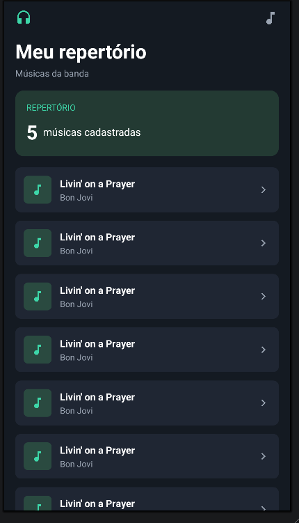
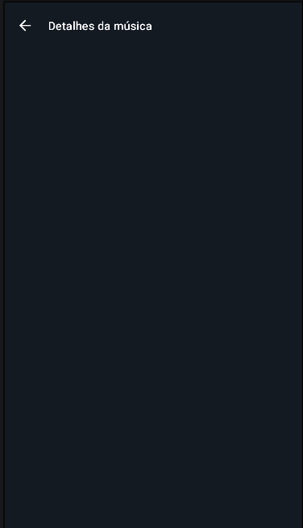
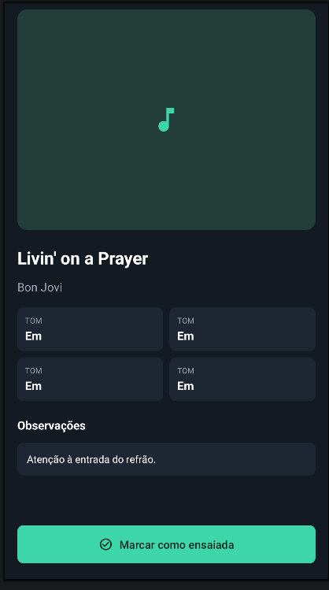
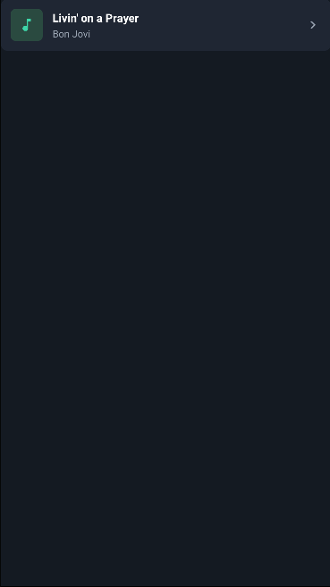
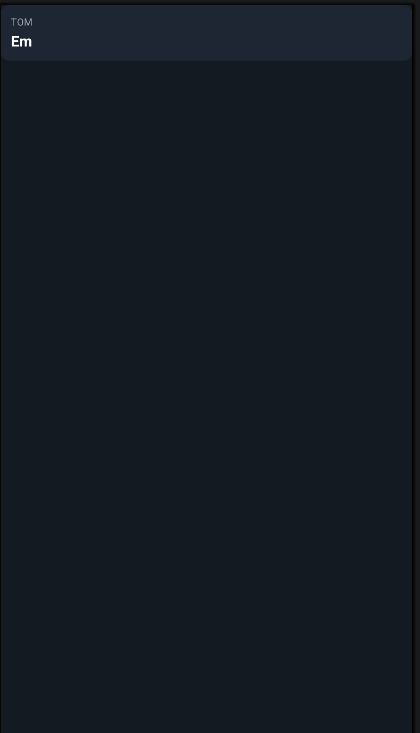

# Gabriel-Goncalves-Pace-AC322B
Repositorio para a avaliação da disciplina de de Programação Mobile I AC322B

## PARCIAL — App "Meu repertório"

Aplicativo Android (Kotlin + XML Views + ViewBinding) para gerenciar o repertório de músicas de uma banda. A tela inicial lista as músicas cadastradas e, ao tocar em uma delas, abre a tela de detalhes, onde é possível marcar a música como ensaiada ou pendente.

Os dados vêm de um mock em memória (`RepertorioMock`, em [Musica.kt](PARCIAL/app/src/main/java/com/example/a3dapp/Musica.kt)).

### Fluxo de navegação

```
MainActivity (lista)  ──clique no item──▶  DetalhesActivity  ──hospeda──▶  DetalhesFragment
      ▲                                        │
      └────────── botão voltar (finish) ◀──────┘
```

`MainActivity` envia o `id` da música via `Intent` (`DetalhesActivity.MUSICA_ID_KEY`). A `DetalhesActivity` valida o id e repassa para o `DetalhesFragment` via `arguments` (`DetalhesFragment.newInstance(id)`). Ao voltar, o `onResume` da `MainActivity` recarrega a lista, refletindo o status atualizado.

---

### Telas

#### 1. Tela principal — `activity_main.xml`



Arquivos: [activity_main.xml](PARCIAL/app/src/main/res/layout/activity_main.xml) · [MainActivity.kt](PARCIAL/app/src/main/java/com/example/a3dapp/MainActivity.kt)

| Componente | Descrição |
|---|---|
| Cabeçalho (`LinearLayout` horizontal) | Ícone de fones (`ic_fones`, cor de destaque) à esquerda e ícone de nota musical (`ic_nota_musical`) à direita, separados por um `Space` com `layout_weight="1"`. |
| Título / subtítulo (`TextView`) | "Meu repertório" (28sp, negrito) e "Músicas da banda" (13sp, cor secundária). |
| Card de resumo (`LinearLayout` com `card_destaque_bg`) | Rótulo "REPERTÓRIO" e a quantidade de músicas (`quantidade_text_view`) + rótulo pluralizado (`quantidade_label_text_view`, via `R.plurals.musicas_cadastradas`). Atualizado no `onResume`. |
| Lista (`RecyclerView` `musicas_recycler_view`) | Ocupa o espaço restante (`layout_weight="1"`), usa `LinearLayoutManager` e o `MusicaAdapter`, que infla um `item_musica` por música. |

#### 2. Tela de detalhes — `activity_detalhes.xml`



Arquivos: [activity_detalhes.xml](PARCIAL/app/src/main/res/layout/activity_detalhes.xml) · [DetalhesActivity.kt](PARCIAL/app/src/main/java/com/example/a3dapp/DetalhesActivity.kt)

| Componente | Descrição |
|---|---|
| `MaterialToolbar` (`detalhes_toolbar`) | Barra superior com ícone de voltar (`ic_voltar`) e título "Detalhes da música". O clique na navegação chama `finish()`. |
| `FragmentContainerView` (`detalhes_fragment_container`) | Container vazio que recebe o `DetalhesFragment`. Por isso aparece em branco na pré-visualização do layout. |

A Activity lê o `musicaId` do `Intent`; se a música não existir, exibe um `Toast` ("Música não encontrada") e fecha. O fragment só é adicionado quando `savedInstanceState == null`, evitando duplicação ao rotacionar a tela.

#### 3. Conteúdo dos detalhes — `fragment_detalhes.xml`



Arquivos: [fragment_detalhes.xml](PARCIAL/app/src/main/res/layout/fragment_detalhes.xml) · [DetalhesFragment.kt](PARCIAL/app/src/main/java/com/example/a3dapp/DetalhesFragment.kt)

| Componente | Descrição |
|---|---|
| `ScrollView` | Envolve todo o conteúdo para permitir rolagem; o botão fica fora dele, fixo no rodapé. |
| Capa (`FrameLayout` com `capa_bg`) | Bloco de 280dp com a nota musical centralizada, simulando a capa da música. |
| Título e artista (`TextView`) | `titulo_text_view` (22sp, negrito) e `artista_text_view` (cor secundária). |
| Grade 2x2 de informações (`<include layout="@layout/item_info">`) | Quatro instâncias do componente reutilizável `item_info`: `tom_info`, `duracao_info`, `status_info` e `genero_info`. Campos nulos exibem "—"; a duração é formatada como `m:ss`. *(Na pré-visualização todos mostram "TOM / Em", pois são `tools:text`.)* |
| Observações (`TextView` com `card_bg`) | Exibe `observacoes` ou o texto padrão "Nenhuma observação.". |
| `MaterialButton` (`ensaiada_button`) | Botão fixo no rodapé que alterna o status da música (`Musica.alternarEnsaiada()`), salva no `RepertorioMock` e atualiza o card de status e o texto do botão ("Marcar como ensaiada" / "Marcar como pendente"). |

O binding é anulado em `onDestroyView` para evitar vazamento de memória.

---

### Componentes reutilizáveis

#### `item_musica.xml` — item da lista



Arquivos: [item_musica.xml](PARCIAL/app/src/main/res/layout/item_musica.xml) · [MusicaAdapter.kt](PARCIAL/app/src/main/java/com/example/a3dapp/MusicaAdapter.kt)

| Componente | Descrição |
|---|---|
| Ícone (`FrameLayout` 40dp com `icone_bg` + `ImageView`) | Nota musical sobre fundo arredondado. |
| Textos (`titulo_text_view`, `artista_text_view`) | Título e artista com `maxLines="1"` e `ellipsize="end"` para não quebrar a linha. |
| `status_image_view` | Se a música está ensaiada, mostra `ic_check_circulo` na cor de destaque; caso contrário, `ic_chevron_direita` na cor secundária. O `contentDescription` muda junto, para acessibilidade. |
| Raiz (`LinearLayout` com `card_bg`) | Usa `selectableItemBackground` como `foreground` para o efeito de toque; o clique chama o callback `onMusicaClick` do adapter. |

#### `item_info.xml` — card rótulo + valor



Arquivo: [item_info.xml](PARCIAL/app/src/main/res/layout/item_info.xml)

| Componente | Descrição |
|---|---|
| `rotulo_text_view` | Rótulo pequeno (10sp, cor secundária), ex.: "TOM", "DURAÇÃO", "STATUS", "GÊNERO". |
| `valor_text_view` | Valor em destaque (15sp, negrito), ex.: "Em", "4:09", "Pendente", "Rock". |

É incluído quatro vezes no `fragment_detalhes` via `<include>` e preenchido pelo método `preencherInfo(info: ItemInfoBinding, rotulo, valor)` do `DetalhesFragment`, evitando repetir o mesmo XML para cada informação.

---

### Modelo de dados — `Musica`

`data class Musica(id, titulo, artista, tom?, duracaoEmSegundos?, genero?, observacoes?, ensaiada)` com validação no `init` (título não vazio e duração > 0) e o método imutável `alternarEnsaiada()`, que retorna uma cópia com o status invertido. O `RepertorioMock` expõe `musicas`, `buscarPorId(id)` e `atualizar(musica)`.
